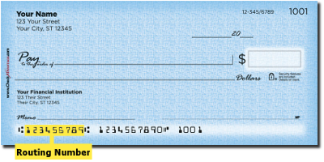

# ABA Routing Validator

**A lightweight Java library for validating ABA Routing Transit Numbers (RTNs).**

Copyright © 2026 Carda Technologies, LLC.

[](https://www.apache.org/licenses/LICENSE-2.0)

---
## Overview

ABA Routing Validator is a lightweight Java library developed by Carda Technologies, LLC, for validating American Bankers Association (ABA) Routing Transit Numbers.

The library performs structural, Federal Reserve prefix, and checksum validation to help Java applications identify invalid routing numbers.

The ABA RTN number can usually (but not always) be found on the bottom left-hand
corner of your personal check.  The last digit of the ABA number is actually
called a "checksum digit".  It's a crude hash of the first eight digits and provides
an initial check for the numbers authenticity.



More information about the ABA routing transit number can be found in the Book of Knowledge:
http://en.wikipedia.org/wiki/Routing_transit_number

---
## Features

- Validates nine-digit ABA Routing Transit Numbers.
- Rejects null and blank input.
- Validates routing number length.
- Requires ASCII numeric digits (`0–9`).
- Validates Federal Reserve routing prefixes.
- Performs the ABA checksum calculation using repeating weights of `3, 7, 1`.
- Provides consistent validation error codes.
- Provides descriptive error mnemonics.
- Supports exception handling with numeric error code retrieval.
- Lightweight implementation using a static utility class.

----------------------------------------------------------------------------
##  Technology Stack

The following software is required to build this project:

| Software |  Version | Download                                                                       |
|:--------:|---------:|--------------------------------------------------------------------------------|
|    |   17.0.9 | https://docs.aws.amazon.com/corretto/latest/corretto-17-ug/downloads-list.html |
|     |    3.9.16 | https://maven.apache.org/download.cgi                                          |


---
## Installation

### <span style="color: #33ccff;"> Maven

Add the following dependency to your project's `pom.xml`:

```xml
<dependency>
    <groupId>com.cardatechnologies</groupId>
    <artifactId>aba-route-validator</artifactId>
    <version>VERSION</version>
</dependency>
```

Replace `VERSION` with the desired release version.

---
## Build Instructions

The POM actually has several build targets.  


### <span style="color: #33ccff;"> Build With Tests
This is the default and the one you will probably run the most.  

This will compile the Jar artifact, and run the JaCoCo and Spotbugs reports.
```bash
    mvn clean install
```

### <span style="color: #33ccff;"> Build With Metrics Reports
This will generate the complete suite of metrics reports.
```bash
    mvn -P genReports clean install site
```

### <span style="color: #33ccff;"> Build Only The Jar Artifact
This will generate the final build artifact and nothing else.
```bash
   mvn -P jar-only clean install-DskipTests
```

---
## Code Metrics Reports
Maven site reports are human-readable documentation and analysis pages generated
automatically during the project's site lifecycle (triggered by the mvn site command)
using the Apache Maven Site Plugin and configured reporting plugins.

The current list of reports includes:

* [Checkstyle Report](https://dcarda.github.io/aba.route.validator/checkstyle.html)
* [CPD (Copy/Paste) Report](https://dcarda.github.io/aba.route.validator/cpd.html)
* [JaCoCo (Code Coverage) Report](https://dcarda.github.io/aba.route.validator/jacoco-report.html)
* [JavaDocs Report](https://dcarda.github.io/aba.route.validator/javadoc-report.html)
* [JavaNCSS Report](https://dcarda.github.io/aba.route.validator/javancss.html)
* [JDepend Report](https://dcarda.github.io/aba.route.validator/jdepend-report.html)
* [XRef Report](https://dcarda.github.io/aba.route.validator/xref-report.html)
* [PMD Report](https://dcarda.github.io/aba.route.validator/pmd.html)
* [SpotBugs Report](https://dcarda.github.io/aba.route.validator/spotbugs.html)
* [Surefire Report](https://dcarda.github.io/aba.route.validator/surefire.html)
* [Tag List (Todo List) Report](https://dcarda.github.io/aba.route.validator/taglist.html)

The reporting site be located [here](https://dcarda.github.io/aba.route.validator/).

---
## Usage

The validator provides a static validation method.

```java
import com.cardatechnologies.utils.validators.abaroutevalidator.AbaRouteValidator;
import com.cardatechnologies.utils.validators.abaroutevalidator.exceptions.AbaRouteValidationException;

public class Example {

    public static void main(String[] args) {

        String routingNumber = "021000021";

        try {
            boolean valid = AbaRouteValidator.validate(routingNumber);

            if (valid) {
                System.out.println("Valid ABA routing number.");
            } else {
                System.out.println("Invalid ABA checksum.");
            }

        } catch (AbaRouteValidationException e) {

            System.out.println("Validation Error: " + e.getMessage());
            System.out.println("Error Code: " + e.getErrorCode());
        }
    }
}
```

---
## Validation Results

The `validate()` method returns a boolean when structural and Federal Reserve prefix validation succeeds.

| Result | Meaning |
|---|---|
| `true` | The routing number passes all validation checks. |
| `false` | The routing number has an invalid checksum. |
| Exception | The input is null, blank, incorrectly sized, contains non-ASCII digits, or has an invalid Federal Reserve prefix. |

---
## Validation Checks

The validator performs the following checks:

1. Input must not be null.
2. Input must not be blank.
3. Input must contain exactly nine characters.
4. All characters must be ASCII digits (`0–9`).
5. The first two digits must represent an accepted Federal Reserve routing prefix.
6. The ABA checksum must be valid.

---
## Federal Reserve Routing Prefixes

The validator recognizes the following routing prefix ranges:

| Prefix Range | Classification |
|---|---|
| `00–12` | Government and Federal Reserve |
| `21–32` | Thrift institutions |
| `61–72` | Payment processors and clearing houses |
| `80` | Traveler's checks |

---
## Error Codes

The library defines the following validation error codes:

| Error Code | Error Mnemonic | Description |
|---|---|---|
| -1000 | `aba.number.null` | Routing number is null. |
| -1001 | `aba.number.blank` | Routing number is blank. |
| -1002 | `aba.number.length.too.short` | Routing number is too short. |
| -1003 | `aba.number.length.too.long` | Routing number is too long. |
| -1004 | `aba.number.contains.non.ascii.digits` | Routing number contains non-ASCII digits. |
| -1005 | `aba.number.invalid.federal.reserve.prefix` | Invalid Federal Reserve prefix. |

---
### <span style="color: #33ccff;"> Exception Handling

Validation errors are represented by `AbaRouteValidationException`, a checked exception.

The exception provides:

- `getErrorCode()` – Returns the numeric validation error code.
- `getMessage()` – Returns the associated error mnemonic.

Example:

```java
try {
    AbaRouteValidator.validate(routingNumber);

} catch (AbaRouteValidationException e) {

    int errorCode = e.getErrorCode();
    String message = e.getMessage();
}
```

---
### <span style="color: #33ccff;"> Error Code Lookup

The `ErrorCodes` enumeration provides a lookup method for retrieving an error enumeration by its numeric code.

```java
ErrorCodes error = ErrorCodes.fromErrorCode(-1002);
```

An `IllegalArgumentException` is thrown if the supplied numeric error code is not recognized.

---
## Limitations

Passing validation does not establish that:

- A financial institution is currently operating.
- A routing number is currently active or accepted.
- A bank account exists.
- A particular bank account belongs to a particular individual or organization.
- A financial transaction can be successfully processed.

Additional verification may be required depending on the intended application.

---
## API Documentation

See the project Javadocs for complete API documentation.

---
## License

This project is licensed under the Apache License, Version 2.0.

See the [LICENSE](LICENSE) file or visit:

https://www.apache.org/licenses/LICENSE-2.0

---
## Copyright

Copyright © 2026 Daniel Carda.

**Developed and maintained by Carda Technologies, LLC.**
<!-- End:  Copyright -->
<!--  ───────────────────────────────────────────────────────────────────────────  -->


---
##  Copyright
(c) 2015-2024  Daniel Carda <GoneBy2025@CardaTechnologies.com>\
All rights reserved.
<!-- End:  Copyright  -->
<!--  ───────────────────────────────────────────────────────────────────────────  -->


---
## About the Developer  👋

Follow this link to learn more about me:

|                                                            Media                                                       | Address                                  |
|:----------------------------------------------------------------------------------------------------------------------:|------------------------------------------|
|                     | https://www.linkedin.com/in/danielcarda/ |
|            | https://github.com/dcarda                |
|                                      | https://danielcarda.net/                 |
<!-- End:  Developer  -->
<!--  ───────────────────────────────────────────────────────────────────────────  -->

---
##  Donate
Donations are always welcome!  Help me out this this and other projects!

[Show your support!](.github/donate.md)

<!-- End:  Donate -->
<!--  ───────────────────────────────────────────────────────────────────────────  -->

---
<p  align="center">
  <i>© <a href="https://danielcarda.net/">Daniel Carda</a> 2015-2027</i><br>
  <i>Licensed under <a href="https://choosealicense.com/licenses/apache-2.0/">Apache 2.0</a></i><br>
  <a href="https://github.com/dcarda">
  </a><br>
  <sup>Thanks for visiting :thumbsup: </sup>
</p>
<!-- End:  Thanks for visiting -->
<!--  ───────────────────────────────────────────────────────────────────────────  -->
