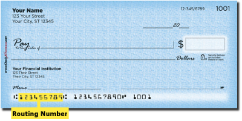

## ABA Routing Number Validator

This module provides a validator which will run a few checks on an ABA routing transit number (ABA RTN) just to make sure it *might* be authentic.

---

# Table of contents

1. [Basic Overview](#overview)
2. [Technolog Stack](#techstack)
3. [Another paragraph](#paragraph2)

---

This module provides a validator which will run a few checks on an ABA routing transit number (ABA RTN) just to make sure it *might* be authentic.

Basically, there are a few rules in constructing a ABA number and this module will try and check to see if those rules have been applied correctly.

The ABA routing transit number (ABA RTN) is a nine-digit code used in the United States to identify a financial institution. All financial institutions in the United States will have at least one ABA RTN number. The ABA routing transit number was created in 1910 by the American Bankers Association.

The number is used by the Federal Reserve Banks to process Fedwire fund transfers. It is also used by the Automated Clearing Houses to process automated transfers, bill payments, and deposits.

The ABA RTN number can usually (but not always) be found on the bottom left-hand corner of your personal check. The last digit of the ABA number is actually called a “checksum digit”. It's a crude hash of the first eight digits and provides an initial check for the numbers authenticity.



More information about the ABA routing transit number can be found in the Book of Knowledge: [http://en.wikipedia.org/wiki/Routing_transit_number](http://en.wikipedia.org/wiki/Routing_transit_number)

---

## [Technology Stack](#technology-stack)

The following software is required to build this project:

| Software | Version | Download |
| --- | --- | --- |
|  | 17.0.9 | [https://docs.aws.amazon.com/corretto/latest/corretto-17-ug/downloads-list.html](https://docs.aws.amazon.com/corretto/latest/corretto-17-ug/downloads-list.html) |
|  | 3.9.6 | [https://maven.apache.org/download.cgi](https://maven.apache.org/download.cgi) |

---

## Social Media

| Media | Address |
| --- | --- |
|  | [https://www.linkedin.com/in/danielcarda/](https://www.linkedin.com/in/danielcarda/) |
|  | [https://github.com/dcarda](https://github.com/dcarda) |
|  | [https://maven.apache.org/download.cgi](https://maven.apache.org/download.cgi) |

## Examples

--- 

The following is a rigious test and will validate an incoming ABA routing number.

```nocode
/**
 * This method will validate an incoming ABA Routing Transit Number.
 *
 * @param paramAbaNumber The ABA number to be validated.
 *
 * @return True if valid.  False if not valid.
 *
 * @throws AbaRouteValidationException Something went *really* wrong.
 */
public boolean validateNumber( final String paramAbaNumber )
        throws AbaRouteValidationException {
    boolean _isValid;

    // Static call to validate.
    _isValid = AbaRouteValidator.validate( paramAbaNumber );

    // Return the result
    return ( _isValid );
}
```

---

## Copyright

(c) 2015-2024 Daniel Carda [CodeWarrior@CardaTechnologies.com](mailto:CodeWarrior@CardaTechnologies.com)  
All rights reserved.

---

## License

> ***[dcarda/aba.route.validator](https://github.com/dcarda/aba.route.validator)** is licensed under [MIT](https://choosealicense.com/licenses/mit/) © [Daniel Carda](https://danielcarda.net/) 2015-2024.*  
> For information, see [TLDR Legal > MIT](https://tldrlegal.com/license/mit-license)

This project is licensed under terms of the MIT license. 

```nocode
Permission is hereby granted, free of charge, to any person obtaining a copy
of this software and associated documentation files (the "Software"), to deal
in the Software without restriction, including without limitation the rights
to use, copy, modify, merge, publish, distribute, sub-license, and/or sell
copies of the Software, and to permit persons to whom the Software is furnished
to do so, subject to the following conditions:

The above copyright notice and this permission notice shall be included install
copies or substantial portions of the Software.

THE SOFTWARE IS PROVIDED "AS IS", WITHOUT WARRANTY OF ANY KIND, EXPRESS OR IMPLIED,
INCLUDING BUT NOT LIMITED TO THE WARRANTIES OF MERCHANT ABILITY, FITNESS FOR A
PARTICULAR PURPOSE AND NON INFRINGEMENT. IN NO EVENT SHALL THE AUTHORS OR COPYRIGHT
HOLDERS BE LIABLE FOR ANY CLAIM, DAMAGES OR OTHER LIABILITY, WHETHER IN AN ACTION
OF CONTRACT, TORT OR OTHERWISE, ARISING FROM, OUT OF OR IN CONNECTION WITH THE
SOFTWARE OR THE USE OR OTHER DEALINGS IN THE SOFTWARE.This is how you dropdown.
```

---

Donations are always welcome! Help me out this this and other projects!

[Show your support!](.github/donate.md)

---

## About the Developer 👋

Follow this link to learn more about me: [Daniel Carda](https://github.com/dcarda)

---

*© [Daniel Carda](https://aliciasykes.com)20156-2024*\ *Licensed under [MIT](https://gist.github.com/Lissy93/143d2ee01ccc5c052a17)*
